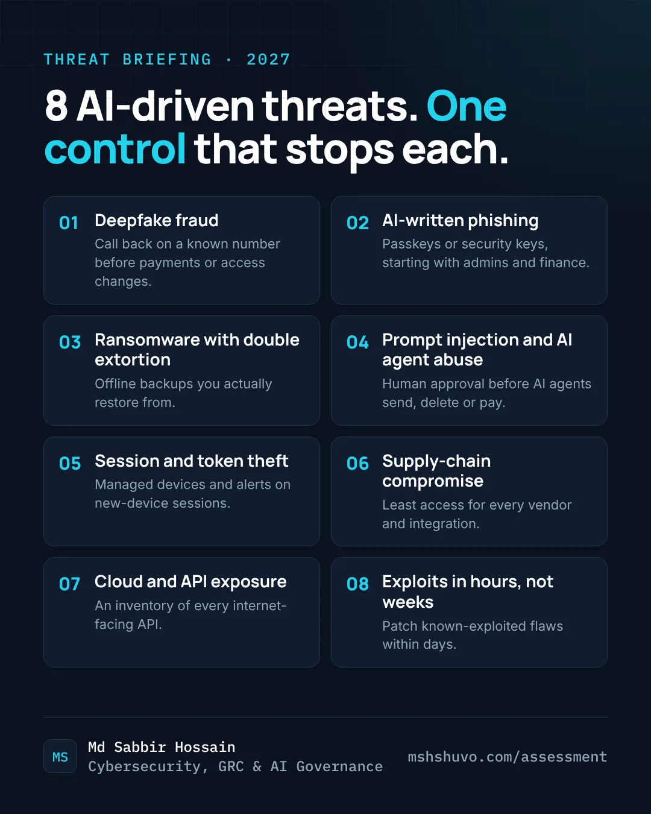

Every year brings another "top threats" list. Most of them name the problem and stop there, which leaves you with a vague sense of worry and nothing to do on Monday morning.

So this one is different in one way: for each threat, I've put the single control I would check first, and a yes/no question. Give yourself a point for every yes. Your score is at the end.

None of these controls are new or expensive. That's the point. AI is making old attacks faster, cheaper and more convincing, and the defences that hold up are mostly the basics, done properly.

## 1. Deepfake fraud

A cloned voice or a live video of your CEO or CFO asks someone to make an urgent payment, change bank details or reset an account. The voice is right, the face is right, and the request comes with pressure.

**The control:** a call-back to a known number before any payment, bank-detail change or access reset. No exceptions for urgency, and no exceptions for seniority.

*Do payment and access changes always need a call-back to a known number?*

## 2. AI-written phishing

The old advice to look for spelling mistakes is finished. AI writes clean, personalised emails using what it finds on your website, LinkedIn and past data leaks, and it does it at scale.

**The control:** phishing-resistant MFA, meaning passkeys or security keys, starting with administrators and finance. A stolen password or a one-time code typed into a fake page is then useless.

*Do your admins and finance staff sign in with passkeys or security keys?*

## 3. Ransomware with double extortion

Attackers now steal your data before they encrypt it. Even if you restore everything, they threaten to publish what they took.

**The control:** offline or immutable backups that you actually restore from on a schedule, plus alerts on unusually large outbound transfers. Backups get you running again; the alerts are your chance to catch the theft before the encryption.

*Have you restored from an offline backup in the last six months?*

## 4. Prompt injection and AI agent abuse

This is the genuinely new one. Once an AI assistant can read your email, files or tickets and act on them, a hidden instruction inside one message or document can make it leak data or take actions you never asked for.

**The control:** least privilege for AI agents, and human approval before they send, delete, share or pay. Treat an AI assistant the way you would treat a new hire with access to finance.

*Do your AI assistants need human approval before they act?*

## 5. Session and token theft

Infostealer malware copies the session cookies from a logged-in browser. The attacker then walks in as you, past both the password and the MFA prompt.

**The control:** short session lifetimes, sign-in only from managed devices for sensitive systems, and alerts when a valid session suddenly appears on a new device or in a new country.

*Would you notice a valid session being used from a new device?*

## 6. Supply-chain compromise

A trusted vendor, plugin, browser extension or software update becomes the way in, using access you already granted.

**The control:** know every vendor and integration that can reach your data, and give each the least access it needs. Review that list at least once a year, and every time a contract renews.

*Do you have a current list of the vendors and tools that can reach your data?*

## 7. Cloud and API exposure

Plenty of breaches need no hacking skill at all: a forgotten API, a test environment left online, or a storage bucket set to public by mistake. Attackers now use AI to find them faster than most teams do.

**The control:** an inventory of every internet-facing API and cloud service, authentication on all of them, and automated scanning for misconfiguration.

*Do you have an up-to-date inventory of your internet-facing APIs?*

## 8. Exploits in hours, not weeks

The gap between a vulnerability being published and attackers using it keeps shrinking. AI helps turn a public advisory into a working exploit quickly, so "we patch monthly" is no longer a plan for internet-facing systems.

**The control:** patch known-exploited vulnerabilities on internet-facing systems within days, and reduce what is exposed in the first place.

*Are known-exploited flaws on your internet-facing systems patched within days?*

## Your score

- **7 to 8:** resilient. Keep testing it, because controls drift.
- **4 to 6:** exposed in places. Start with whichever "no" would hurt most if it happened tomorrow.
- **0 to 3:** high risk. Backups, phishing-resistant MFA and approval rules first. They cover more of this list than anything else.

## Want a fuller picture?

This list is a quick read, not an assessment. If it raised a few uncomfortable "no" answers, my free readiness checks go deeper in about two minutes each, with a score and the first fix for every gap. No sign-up needed.

- [Ransomware and incident readiness](/assessment/ransomware) covers backups, MFA, detection and your response plan.
- [ISO 42001 AI governance](/assessment/iso-42001) covers the AI side: policy, risk, impact and third-party AI.
- [All readiness checks](/assessment), including NIST CSF 2.0 and ISO 27001.
