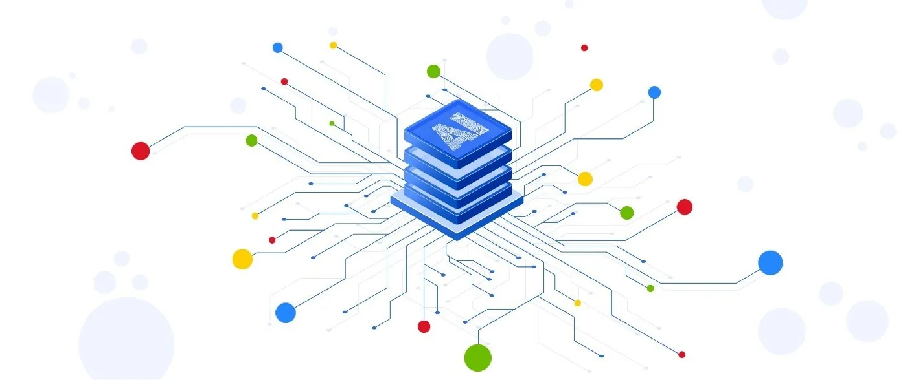

Recently, many reports and analyses have been created that try to predict how dynamically the labor market will evolve in response to the development of artificial intelligence. World Economic Forum, Gartner, McKinsey- everyone is trying to estimate the scale and tame us with inevitable change. The subsequent numbers cause a lot of noise and mixed moods around the AI. However, is there really something to worry about and how specialists developing artificial intelligence perceive these processes?

The World Economic Forum (WEF) has analyzed how large, international employers look at the employment structure in the perspective of 2022. Last year’s Future of Work report identified jobs that are threatened with disappearance, stable roles that AI does not threaten, and that 133 million new jobs are estimated to be created. A comparison of 2018 to 2022 clearly shows that the 10% reduction in some types of jobs will be fully offset by the creation of new jobs and the emergence of new professions (an increase of 11%). In turn, 48% of today’s jobs defined as universal, representing the majority of employment in various industries, will remain at the same level until 2022.

AI will not replace people. It will give them new opportunities and new jobs. The rapid development of technology, however, does not go hand in hand with its rapid implementation and social acceptance. Over the next few years, we will see an increase in automated processes thanks to AI in environments that are structured and repeatable, which will begin to eliminate human participation in performing such roles as an accountant, post clerk or production line employee. However, remember that this will not happen overnight. In addition, ordinary Kowalski is to prepare for a greater demand for technical, ethical or social skills, but without forgetting about creativity during strong globalization — believes technical experts around the world.

The popular discourse about the future of working with AI focuses mainly on the vision of technology that replaces people. In the meantime, it should be remembered that automation and artificial intelligence would create many new jobs. There will be positions that combine previously known competences with previously unused areas of technology and create new value on the market, while being well paid, such as Artificial Intelligence Engineer and Machine Learning Engineer. Relatively recently, there has been a demand for specialists dealing with, for example, the area of ethics in AI, which shows how comprehensive approach to artificial intelligence is needed. This generates new jobs that we have never dreamed of before. WEF lists big data and digital transformation specialists, researchers and data analysts or robotics specialists on the list of new jobs created by AI. This may surprise us a little, because these roles already sound quite familiar. However, they are relatively new and the demand for them will definitely increase. In addition, what undiscovered professions will bring the next years? Who can see this today?

The emergence of completely new professions is on the one hand an opportunity for employees, but on the other — a certain challenge, requiring the acquisition of new competences. Professionally active people do not have to passively wait for what the future holds, but they can take care of developing their skills and acquiring new ones today. To properly prepare for meeting the requirements of new positions, which will appear along with the development of artificial intelligence and progressive automation, you should develop your competencies in two ways. First of all, it is always worth expanding knowledge about new technologies, being up to date with the latest solutions, and having knowledge about current and forecast trends. Nevertheless, machines will not replace people in areas where we will still outperform them. Creativity, teamwork, emotional intelligence or ethics are areas that will remain the domain of people for a long time and it is worth investing in the development of soft competences combined with technologies.
