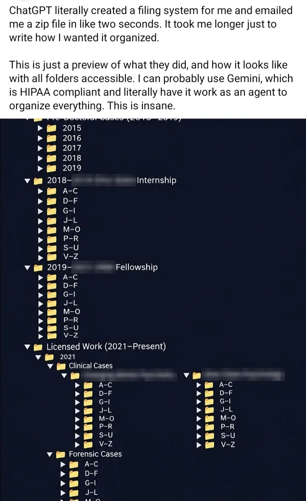

## The post that caught my eye

A licensed psychologist recently posted, with obvious excitement, that ChatGPT built him a complete filing system for his patient case files in seconds. Training-era cases, fellowship cases, clinical and forensic work, each bucketed A–C, D–F and so on.

Then came the line that made me stop scrolling: he could probably use Gemini, "which is HIPAA compliant", and have it work as an agent to organize everything.

I understand the excitement. The productivity gain is real. But as a risk and compliance practitioner, I read that sentence as a risk statement, not a productivity tip. Here is why, broken down the way I would assess it for a client.

## Two steps, two very different risk levels

Fairness first: what he has already done is probably harmless. What he plans to do next is not.

- **Step 1, done (ChatGPT):** he described the structure he wanted and got back a zip of empty folders. If only the design went in and no patient names or files, no protected health information (PHI) left his hands. The one open question is whether any patient data was uploaded to get there.
- **Step 2, planned (Gemini as an agent):** an AI with live access to read, move and rename real clinical and forensic records. This is where the risk sits.

The gap between the two is the whole story. Designing a folder tree is a writing task. Letting an autonomous agent operate on mental-health and forensic records is a data-processing decision with legal, ethical and security consequences.

## The myth: "Gemini is HIPAA compliant"

No software is HIPAA compliant on its own. Compliance belongs to the organization, and it depends on how the tool is contracted, configured and used.

Google does list the Gemini app and Gemini in Google Workspace among the services covered by its Business Associate Agreement (BAA). But that coverage comes through a qualifying Workspace plan with the BAA actually signed. Independent guidance is consistent that the consumer Gemini app on a personal Google account has no BAA at all. Google's own page puts it plainly: ultimately, you are responsible for evaluating your own HIPAA compliance.

So the honest answer to "Is Gemini HIPAA compliant?" is: **it depends which Gemini, under which account, with which contract, configured how.** A clinician reading a vendor headline and concluding "I'm covered" is the most common, and most dangerous, misunderstanding in healthcare AI right now.

Even a signed BAA only covers how the vendor handles the data you send. It does nothing about what the agent does with your files once you give it access.

## The risk register

Assessed as the plan was described: an AI agent with broad access to the full archive, with no stated contract, scoping, logging or backup. Ratings are inherent risk, before any controls.

| # | Risk | Category | Likelihood | Impact |
| --- | --- | --- | --- | --- |
| 1 | PHI processed under a personal account with no BAA, making it an unauthorized disclosure | Regulatory | High | High |
| 2 | Psychotherapy notes, which HIPAA protects more strictly, swept into bulk AI processing | Regulatory | High | High |
| 3 | Forensic records moved or renamed by AI, so their integrity and chain of custody can be challenged | Legal | Medium | High |
| 4 | Excessive agency: read, write and delete access to everything for a sorting task | AI security | High | High |
| 5 | Prompt injection: text inside a referral letter or court document redirects the agent | AI security | Medium | High |
| 6 | Hallucinated actions: misfiled patients, merged same-surname records, silently dropped files | Integrity | Medium | High |
| 7 | No audit trail of what the agent read or changed | Integrity / accountability | High | Medium |
| 8 | Bulk rename or delete with no tested backup, so records are lost | Availability | Low | High |
| 9 | Vendor retention or human review of prompts and outputs, depending on account terms | Confidentiality | Medium | High |
| 10 | Records from former employers and clinics processed without their knowledge | Third party / contractual | Medium | Medium |
| 11 | State law and licensing board duties (retention, confidentiality) breached on top of HIPAA | Regulatory | Medium | High |
| 12 | Public post normalizes the practice, so peers copy it with consumer accounts | Governance / shadow AI | High | Medium |

**Root cause:** false assurance. Almost every row above traces back to one belief: the vendor said HIPAA, so I'm covered.

**Why the impact column is so heavy:** mental-health and forensic data is among the most damaging data that can leak. It can affect custody cases, employment and reputation, and it can be used for blackmail. Unlike a password, it can never be changed or taken back. And every leak erodes the trust that makes therapy work.

## What "done right" looks like

The answer is not "never use AI". It is "not like this". Most of the register drops to low or medium residual risk with controls any practice can put in place:

1. **Right contract, right account:** a business Workspace or cloud plan, with the BAA signed and the specific AI service confirmed as covered. No personal accounts, ever.
2. **Minimum necessary:** have the AI design the structure and propose a mapping. Don't give it the records themselves unless the task truly needs them.
3. **Least privilege:** read-only access by default, scoped to one folder at a time. No delete permission.
4. **Human in the loop:** the agent proposes moves; a person approves them in batches.
5. **Logging:** a record of every file the agent read and every change it made.
6. **Backup first:** a verified, restorable backup before any bulk operation.
7. **Carve-outs:** psychotherapy notes and forensic files are excluded, or handled manually.
8. **Paper trail:** a short risk assessment and AI use policy on file, which a regulator or court will ask to see.

These map directly to the HIPAA Security Rule safeguards, the NIST AI Risk Management Framework, ISO/IEC 27001 access control and ISO/IEC 42001 AI management. None of it is exotic. It just has to happen before the agent gets the keys, not after.

## The takeaway

**The AI isn't the risk. Unscoped autonomy over the most sensitive data there is, running on false assurance, is.**

To clinicians and practice owners: before you hand an agent your patient files, ask four questions.

- Which exact product and account am I using, and is there a signed BAA that names it?
- Does this task actually need patient data, or just the structure?
- What is the worst thing this agent could do with the access I'm giving it?
- If a regulator or a court asked tomorrow, could I show what it touched?

If you can't answer all four, you're not ready to switch it on. Happy to help any practice work through them.

## Sources

- [HIPAA compliance on Google Cloud and Google Workspace](https://docs.cloud.google.com/docs/security/compliance/hipaa) (Google)
- [Gemini BAA coverage by product](https://aptible.com/hipaa-compliant-ai-tools/gemini-baa) (Aptible)
- [Is Gemini HIPAA compliant? 2026 guide](https://www.strac.io/blog/is-gemini-hipaa-compliant) (Strac)
- [OWASP Top 10 for LLM Applications](https://genai.owasp.org/llm-top-10/)
- [NIST AI Risk Management Framework](https://www.nist.gov/itl/ai-risk-management-framework)
